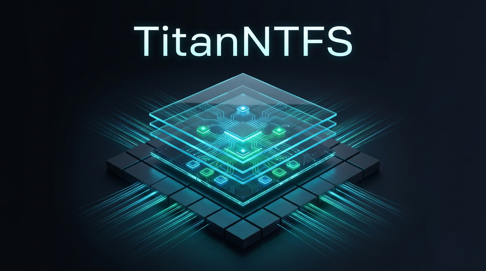

# TitanNTFS: High-Performance NTFS Engine for Windows

[](https://github.com/MicaNT-Kernel/TitanNTFS/actions/workflows/ci.yml)
[](LICENSE)
[]()
[](CLEAN_ROOM_PROVENANCE.md)



**TitanNTFS** is an independent, clean-room implementation of the **New Technology File System (NTFS)** architecture designed in modern ISO C++23. Built from first principles, TitanNTFS delivers userland volume formatting, File Explorer drive mounting via WinFsp, Alternate Data Streams (ADS), Master File Table ($MFT) record manipulation, autonomous torn-write repair, and Update Sequence Array (USA) validation for Windows and POSIX platforms.

---

## Key Features

- **1024-byte MFT Record Architecture**: Clean-room implementation of resident and non-resident attributes, standard information ($STANDARD_INFORMATION), file names ($FILE_NAME), and data streams ($DATA).
- **Update Sequence Array (USA) Fixups**: Full generation and verification of USN fixup arrays across 512-byte sector boundaries to detect and repair torn writes.
- **Alternate Data Streams (ADS)**: Native support for multi-stream file attributes (e.g. `file.txt:Zone.Identifier`, custom metadata tags).
- **Run-Length Encoded Data Runs**: LCN / VCN cluster extent mapping for non-resident file and directory streams.
- **WinFsp User-Mode Driver Bridge (`titanntfs_mount`)**: Mount any NTFS volume or raw disk image to standard Windows drive letters (e.g. `N:\`) with native File Explorer, Command Prompt, PowerShell, and application integration.
- **Windows NT Background Service (`titanntfs_svc`)**: Background auto-mount engine and 24-hour autonomous MFT consistency / torn-write scrubber with Named Pipe IPC (`\\.\pipe\titanntfs_ipc`).
- **MFT Repair & Recovery Tool (`titanntfs_check`)**: chkdsk-style volume analysis, USA fixup restoration, and automated record repair via `--repair` / `/f`.
- **1-Click Standalone Installer (`titanntfs_setup`)**: Single executable embedding all binaries, assets, and the signed WinFsp driver in an LZ4-compressed payload.
- **Strict Clean-Room Provenance**: 100% written from first principles under 17 U.S.C. § 1201(f) interoperability standards, audited on every commit by our automated Sentinel.

---

## Utilities & Architecture

### 1. `titanntfs_mount` (User-Mode Filesystem Bridge)
Mounts any raw disk image (`.raw`, `.img`, `.vhdx`) or physical drive to a Windows drive letter:
```bash
# Mount an existing NTFS disk image to N:
titanntfs_mount ntfs_disk.raw N:

# Format and mount a 512MB NTFS volume with custom label
titanntfs_mount ntfs_disk.raw N: --format --label Storage --size 512

# Mount physical drive
titanntfs_mount \\.\PhysicalDrive1 N:
```

### 2. `titanntfs_svc` (Windows NT Background Service)
Autonomous service daemon for volume auto-mounting, IPC, and 24-hour MFT integrity scrubbing:
```bash
# Register and start as Windows Auto-Start Service
titanntfs_svc install

# Run in interactive console debug mode
titanntfs_svc run

# Uninstall service
titanntfs_svc uninstall
```

### 3. `titanntfs_check` (Inspection & Scrubber Tool)
Inspect volume boot records, verify MFT integrity, and perform automated torn-write repairs:
```bash
# Inspect and verify MFT records
titanntfs_check my_disk.raw

# Perform automated repair on corrupted records
titanntfs_check my_disk.raw --repair
```

### 4. `titanntfs_format` (CLI Formatting Utility)
Format any disk image or physical partition to NTFS:
```bash
titanntfs_format my_disk.raw --size 256 --cluster 4096 --label "TitanNTFS"
```

### 5. `titanntfs_setup` (Standalone GUI Installer)
Pure Win32 dark-mode GUI installer with Left-Sidebar Studio layout, automatic WinFsp detection, silent driver deployment, PATH configuration, and Windows Add/Remove Programs integration.

---

## Building from Source

### Prerequisites
- CMake 3.24+
- Modern C++23 Compiler (Clang 18+, MSVC 2022 v17.8+, or GCC 14+)
- Ninja build tool (recommended)

### Windows Build (Clang / Ninja)
```bash
cmake -B build -G Ninja -DCMAKE_BUILD_TYPE=Release
cmake --build build -j2
```

### Run Test Battery
```bash
ctest --test-dir build --output-on-failure
# Or directly:
./build/titanntfs_tests
```

### Run Clean-Room Sentinel Audit
```bash
node scripts/clean_room_sentinel.js --local
```

### Create Distribution ZIP
```bash
cpack --config build/CPackConfig.cmake -B build/dist
```

---

## Legal & Clean-Room Architecture
TitanNTFS is an independent clean-room implementation developed for functional interoperability under 17 U.S.C. § 1201(f) and SCOTUS fair use doctrine (*Google v. Oracle*). See [CLEAN_ROOM_PROVENANCE.md](CLEAN_ROOM_PROVENANCE.md) for full compliance declarations.

---

## License
Licensed under the Apache License, Version 2.0.  
Copyright © 2026 Daniel Elliott <ssfdre38@gmail.com>.
